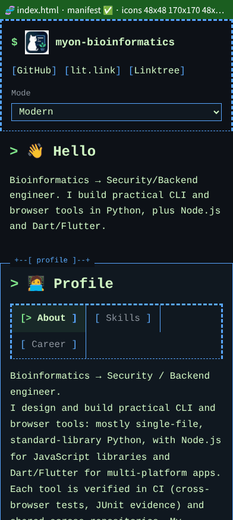
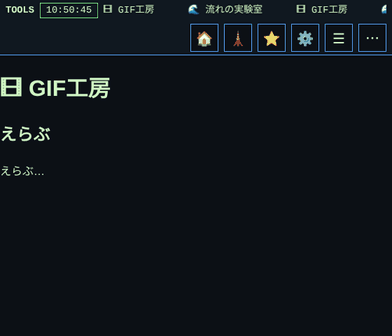
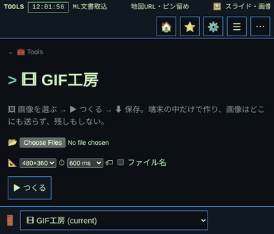

<p align="center">
  
</p>

<h1 align="center">🧭 myon-bioinformatics.github.io</h1>
<p align="center">公開リポジトリのポートフォリオ / project hub — <a href="https://github.com/myon-bioinformatics">myon</a></p>

<p align="center">
  
  
  <a href="https://github.com/myon-bioinformatics"></a>
  <a href="https://twitter.com/myonitbusiness"></a>
</p>

このリポジトリは [GitHub Pages](https://myon-bioinformatics.github.io/) で公開している、myon-bioinformatics の**公開リポジトリ向けポートフォリオ / プロジェクトハブ**です。トップページでは公開・非アーカイブのリポジトリをカードで一覧し、🌐 各リポジトリの利用ガイド（GitHub Pages）や、このサイト上の 🧰 Tools（実用の道具）へ案内します。

はじめての方や採用の方向けの短い自己紹介は、下の **Intro/Profile** が早いです。

Artwork: the supplied cat/code/plant icon and favicon are cropped from the new project brand sheet.
The pair labelled `yourself` is assigned here to the portfolio; the parent and Yourself repository icons remain unchanged.
See [brand assets and concept-review notes](docs/brand-assets.md).

## 🗺️ 概念図

[](assets/brand/repository-concept.jpg)

2026-10-22 にいただいた概念図を、加工せず掲載しています。全体の方向を示すもので、[いまの技術の主軸や図との差分](docs/brand-assets.md#概念図の確認メモ2026-10-22)は別に記録しています。

---

## 📍 公開サイト

- **Site:** https://myon-bioinformatics.github.io
- **Intro/Profile:** https://github.com/myon-bioinformatics
- **Links:** <a href="https://lit.link/myon123">lit.link</a> / <a href="https://linktr.ee/myon123">Linktree</a>

> If you’re a beginner or recruiter and want a quick overview of me, the **Intro/Profile** link above is the fastest route.

---

## 🖼️ 最新の公開画面

Latest successful render — GitHub Pages のデプロイが成功したときだけ、次の安定 URL に Chromium のスクリーンショットが置き換わります。実行ごとのアーカイブではなく、人間向けの `latest` です。

- [Desktop 1440×900](https://myon-bioinformatics.github.io/evidence/latest/desktop.png)
- [Mobile 390×844](https://myon-bioinformatics.github.io/evidence/latest/mobile.png)
- [Evidence metadata (SHA / timestamp / viewport)](https://myon-bioinformatics.github.io/evidence/latest/meta.json)

[](https://myon-bioinformatics.github.io/evidence/latest/desktop.png)

The inline README preview uses a cache-busting query only for GitHub's image
proxy. The link target remains the stable `/evidence/latest/desktop.png` URL.

---

## 🔄 サイトの作り方と更新

トップページの `index.html` は git に置かず、公開のたびに Python が書きます。`scripts/front_page.py` が `profile.json`・`api/repos.json`・`projects.json` からページを組み立て、`scripts/project_pages.py` がピン留めした [PySaiyanWeBoo](https://github.com/myon-bioinformatics/PySaiyanWeBoo) で共有 UI や道具ページを生成します。正本の役割は [docs/ssot.md](docs/ssot.md) を参照してください。

| 正本 | 役割 |
| --- | --- |
| `profile.json` | 短い自己紹介・スキル・経歴・いまの関心 |
| `api/repos.json` | GitHub から生成した公開リポジトリの事実（URL・説明・トピック・⭐・Pages の有無）。手編集しない |
| `projects.json` | 任意の説明の上書き・追加トピック。カタログにないリポジトリは足せない |
| `services.json` | このサイトが持つ公開エンドポイント（サブページなど、カタログから導けない URL） |
| `site.config.json` | プロジェクト一覧の初期表示。いまは `defaultViewMode: modern` |

主な workflow（いずれもイベントまたは定期実行あり）:

- **Update repos API**（[`.github/workflows/repos-api.yml`](.github/workflows/repos-api.yml)）— 毎日 06:00 JST（`cron: "0 21 * * *"`）と、カタログ用スクリプト / Pages workflow の変更時。`api/repos.json` を更新する。`GITHUB_TOKEN` による commit は `push` workflow を起こさないため、成功時だけ **Pages** を `workflow_run` で起動する。失敗・キャンセルではサイトを出し直さない。
- **Pages**（[`.github/workflows/pages.yml`](.github/workflows/pages.yml)）— `main` への push、および上記の成功後。公開用に指定した静的ファイルを `--copy-source` で配置し、動く見本 GIF・流れの実験室・リポジトリ地図・他リポジトリから組む道具をベストエフォートで足し、検証済みの共有資産を書いて公開する。
- **CI** など — 変更の検証。[HTML import published](.github/workflows/html-import-published.yml) は Pages 完了後に、公開済みの HTML 取込をブラウザで確認する。

カードの検索・トピック絞り込みは 5 つの表示モードで共通です。候補の並びはページを開くたびにシャッフルされます。アーカイブ済みの公開リポジトリはカタログに残っても、サイトの Projects には出しません。

## 🧰 Tools

トップの **🧰 Tools** は、実用の道具だけを置く棚です（リポジトリカードとは別に手で管理）。各リポジトリの使い方・検証・GIF は、そのリポジトリの Pages（🧩 機能一覧 / 🔬 検証ガイド / 🎞 GIF デモ）にあり、ここでは写しません。組み立ての要るもの（ビルド）だけをここで作ります。カード名は用途、🧩 出どころはその部品のリポジトリです。公開時に他リポジトリの default branch から組むもの（Ironmate のスタジオ、mcp-toolcall-lab、DRAgoWing のヒートマップなど）は、組み立てに失敗すると ⏸ ページになります。コード本体は各リポジトリに残します。

| 案内 | リンク |
| --- | --- |
| HTML文書取込 | [tools/html-import/](https://myon-bioinformatics.github.io/tools/html-import/) |
| 地図URL・ピン留め | [tools/maps/](https://myon-bioinformatics.github.io/tools/maps/) · [パラレル東京](https://myon-bioinformatics.github.io/tools/maps/tokyo.html) |
| 🖼️ スライド・画像工房（Ironmate） | [Image Studio](https://myon-bioinformatics.github.io/tools/image-studio/) · [Browser Tools](https://myon-bioinformatics.github.io/tools/browser-tools/) · [Slide Studio](https://myon-bioinformatics.github.io/tools/slide-studio/) |
| 🌡️ ヒートマップ（DRAgoWing · Ironmate） | [tools/heatmap/](https://myon-bioinformatics.github.io/tools/heatmap/) |
| 🔌 MCP 実験室（mcp-toolcall-lab） | [Tool Lab](https://myon-bioinformatics.github.io/tools/mcp/) · [Execution Lab](https://myon-bioinformatics.github.io/tools/mcp/execution/) |
| 🤖 Stubs & mocks | [tools/demos/](https://myon-bioinformatics.github.io/tools/demos/) |
| 💬 横断チャット（markdown · ascii_artist · cli_args · TalkCompress · mcp-toolcall-lab） | [tools/demos/chat.html](https://myon-bioinformatics.github.io/tools/demos/chat.html) |
| 🧭 統合運用 | [Dashboard](https://myon-bioinformatics.github.io/myon-bioinformatics/) |
| 🎞 GIF工房（PySaiyanWeBoo） | [tools/gif/](https://myon-bioinformatics.github.io/tools/gif/) |
| 🌊 流れの実験室（FluidFullSpeedSimulation · DRAgoWing） | [tools/flow/](https://myon-bioinformatics.github.io/tools/flow/) |
| 🧠 リポジトリ地図 | [tools/repo-map/](https://myon-bioinformatics.github.io/tools/repo-map/) |

新しい道具を足すときは、生成元の `scripts/front_page.py`（`PORTAL`）と `tests/test_site.py` をいっしょに直し、行き先と HTTPS の Pages 契約を同じ変更で確認します。

🧰 Ironmate's Image Studio, Browser Tools and Slide Studio (`tools/image-studio/`, `tools/browser-tools/`, `tools/slide-studio/`), mcp-toolcall-lab's tools and execution lab (`tools/mcp/`, `tools/mcp/execution/`) and DRAgoWing's 🌡️ heatmap (`tools/heatmap/`) are built here at deploy time from each repository's default branch (`scripts/project_pages.py --record-tools`; the code stays in those repositories). A build that could not record one leaves a ⏸ page in its place. Ironmate has a local metadata card (`project-ironmate.json`). Its retired MCP stub is not linked. Studio route mapping is build source in `_src/tools/studio_routes.py`; the rendered pages live only in the Pages output tree. Ironmate still owns the generated editor and data formats, and the shared back navigation comes from PySaiyanWeBoo.

## 🚀 公開リポジトリ

サイトの Projects は、公開・非アーカイブのリポジトリが対象です。名前は GitHub、**🌐 Pages** はその利用ガイド、**📄** があるものはこのポートフォリオ上の記録ページです。下は同じ公開リポジトリをテーマ別にしたもので、説明は各リポジトリの GitHub 説明（またはこのリポジトリのキュレーション）に沿っています。最新の所属・URL は `api/repos.json` が正本です。

### このサイト・紹介

| リポジトリ | 一言 | 🌐 Pages |
| --- | --- | --- |
| [myon-bioinformatics.github.io](https://github.com/myon-bioinformatics/myon-bioinformatics.github.io) | このポートフォリオ | https://myon-bioinformatics.github.io/ |
| [myon-bioinformatics](https://github.com/myon-bioinformatics/myon-bioinformatics) | プロフィール（About me for everyone）と横断の運用ダッシュボード | https://myon-bioinformatics.github.io/myon-bioinformatics/ |

### 野球データ研究（Aoi 系）

| リポジトリ | 一言 | 🌐 Pages |
| --- | --- | --- |
| [Aoi](https://github.com/myon-bioinformatics/Aoi) | 答えより、より良い問いを探す野球（NPB）研究の枠組み | https://myon-bioinformatics.github.io/Aoi/ |
| [QueRyu](https://github.com/myon-bioinformatics/QueRyu) | NPB ページの、礼儀正しく再現可能な取得 | https://myon-bioinformatics.github.io/QueRyu/ |
| [BlueProbe](https://github.com/myon-bioinformatics/BlueProbe) | 解釈の前に、NPB ページの HTML/CSS/DOM を観察して取り出す | https://myon-bioinformatics.github.io/BlueProbe/ |
| [SakAnalytics](https://github.com/myon-bioinformatics/SakAnalytics) | シーズン指標・マジックナンバーシミュレーション | https://myon-bioinformatics.github.io/SakAnalytics/ |
| [PythDRagoras](https://github.com/myon-bioinformatics/PythDRagoras) | 説明を命題として反例と突き合わせ、規則を探す | https://myon-bioinformatics.github.io/PythDRagoras/ |
| [DRAgoWing](https://github.com/myon-bioinformatics/DRAgoWing) | 研究記録を再判定せず、Plotly.js の報告や図にする | https://myon-bioinformatics.github.io/DRAgoWing/ |
| [NagoyAction](https://github.com/myon-bioinformatics/NagoyAction) | 研究パイプラインを TOML で一度定義し、手元と Actions で同じコマンドを回す | https://myon-bioinformatics.github.io/NagoyAction/ |

### 生命科学

| リポジトリ | 一言 | 🌐 Pages |
| --- | --- | --- |
| [search_seq_including_spaces](https://github.com/myon-bioinformatics/search_seq_including_spaces) | DNA / タンパク質配列向けの、標準ライブラリだけの Python CLI | https://myon-bioinformatics.github.io/search_seq_including_spaces/ |

### 単一ファイルのツール

| リポジトリ | 一言 | 🌐 Pages |
| --- | --- | --- |
| [gh_identity](https://github.com/myon-bioinformatics/gh_identity) | GitHub CLI を観察する、標準ライブラリだけの単一ファイル | https://myon-bioinformatics.github.io/gh_identity/ |
| [xprobe](https://github.com/myon-bioinformatics/xprobe) | テキスト検索・境界ケース・失敗寄りのテスト支援 | https://myon-bioinformatics.github.io/xprobe/ |
| [yourself](https://github.com/myon-bioinformatics/yourself) | ホスト・OS・ランタイムの事実を読み取り専用で出す | https://myon-bioinformatics.github.io/yourself/ |
| [cli_args](https://github.com/myon-bioinformatics/cli_args) | CLI 引数の定義・検証・実行・出力の再利用部品 | https://myon-bioinformatics.github.io/cli_args/ |
| [markdown](https://github.com/myon-bioinformatics/markdown) | 標準ライブラリだけの Markdown ユーティリティ | https://myon-bioinformatics.github.io/markdown/ |
| [ascii_artist](https://github.com/myon-bioinformatics/ascii_artist) | ASCII アートとテキスト図の生成・変換・配置 | https://myon-bioinformatics.github.io/ascii_artist/ |
| [Err-o-RoadRunner](https://github.com/myon-bioinformatics/Err-o-RoadRunner) | 失敗が起きるまで待ってから、FOUND / NOT FOUND / HINT を出す | https://myon-bioinformatics.github.io/Err-o-RoadRunner/ |
| [nvd_nist_known_vulns](https://github.com/myon-bioinformatics/nvd_nist_known_vulns) | NVD CVE API 2.0 の、標準ライブラリだけのクライアント | https://myon-bioinformatics.github.io/nvd_nist_known_vulns/ |
| [OneLaunchNumerousModules](https://github.com/myon-bioinformatics/OneLaunchNumerousModules) | bash/zsh のワンライナーと、標準ライブラリのツール起動、閉じたネットワーク向けのダイヤル | https://myon-bioinformatics.github.io/OneLaunchNumerousModules/ |

### 文書・画像・UI・資産

| リポジトリ | 一言 | 🌐 Pages |
| --- | --- | --- |
| [Ironmate](https://github.com/myon-bioinformatics/Ironmate) | Markdown→PPTX、既存 PPTX の編集、Image / Slide Studio | https://myon-bioinformatics.github.io/Ironmate/ |
| [PySaiyanWeBoo](https://github.com/myon-bioinformatics/PySaiyanWeBoo) | 静的ページ向けの共有 CSS テーマと UI 部品（標準ライブラリの 1 モジュール） | https://myon-bioinformatics.github.io/PySaiyanWeBoo/ |
| [CaChereCyCle](https://github.com/myon-bioinformatics/CaChereCyCle) | アイコンや概念図などの公開資産を JSONL にまとめ、片付けて再利用する | https://myon-bioinformatics.github.io/CaChereCyCle/ |

### LLM / MCP

| リポジトリ | 一言 | 🌐 Pages |
| --- | --- | --- |
| [mcp-toolcall-lab](https://github.com/myon-bioinformatics/mcp-toolcall-lab) | LLM が MCP ツールを見つけて呼ぶ過程の、再現可能な実験 | https://myon-bioinformatics.github.io/mcp-toolcall-lab/ |
| [TalkCompress](https://github.com/myon-bioinformatics/TalkCompress) | 読む相手にとって意味が残る、短い表現の実験 | https://myon-bioinformatics.github.io/TalkCompress/ |

### 検証・シミュレーション

| リポジトリ | 一言 | 🌐 Pages |
| --- | --- | --- |
| [BrowserTestKit](https://github.com/myon-bioinformatics/BrowserTestKit) | Playwright のクロスブラウザ検証と、スクリーンショット証拠 | https://myon-bioinformatics.github.io/BrowserTestKit/ |
| [FluidFullSpeedSimulation](https://github.com/myon-bioinformatics/FluidFullSpeedSimulation) | このポートフォリオの「流れの実験室」でも記録を使う公開リポジトリ（GitHub 説明文は未設定） | https://myon-bioinformatics.github.io/FluidFullSpeedSimulation/ |

### オントロジー

| リポジトリ | 一言 | 🌐 Pages |
| --- | --- | --- |
| [ONTO](https://github.com/myon-bioinformatics/ONTO) | オントロジー関連リポジトリをつなぐ索引 | https://myon-bioinformatics.github.io/ONTO/ |
| [TaxOntOy](https://github.com/myon-bioinformatics/TaxOntOy) | Taxonomy × Ontology | https://myon-bioinformatics.github.io/TaxOntOy/ |
| [TopOntoLogy](https://github.com/myon-bioinformatics/TopOntoLogy) | Topology × Ontology | https://myon-bioinformatics.github.io/TopOntoLogy/ |
| [OnTautoLogy](https://github.com/myon-bioinformatics/OnTautoLogy) | 標準ライブラリの graphlib による知識グラフ（順序・閉路・オントロジー検査） | https://myon-bioinformatics.github.io/OnTautoLogy/ |

## 🎨 見た目とブランド

ツールページの見た目は、ピン留めした PySaiyanWeBoo の CSS 層（`tokens → base → components → themes/modern`）と `ui-*` クラスでそろえています。プロジェクト一覧の初期表示も `modern`（`site.config.json`）で、ヘッダーから `xml-like` / `json` / `markdown` / `github-like` に切り替えでき、選択はブラウザの local storage に残ります。色テーマも PySaiyanWeBoo のパレットです。

このサイト自身のアイコンとファビコンは `assets/brand/` です（プロフィールアイコン、16 / 32 / 48 の PNG、`favicon.ico`、`manifest.webmanifest`）。記録と切り出しの注記は [docs/brand-assets.md](docs/brand-assets.md) にあります。

他の公開リポジトリの利用ガイドからは、🏠 ポートフォリオとしてこのサイトへ戻るリンクが置かれているものがあります。ガイド側の `docs/guide.page.json` や favicon 一式は各リポジトリが持っており、このリポジトリがそれらを配布しているわけではありません。

## 🎛️ Display mode

- Default mode is **modern**
- Repository default can be changed via `site.config.json`:
  - `defaultViewMode`: `modern`, `xml-like`, `json`, `markdown`, or `github-like`
- Users can switch mode from the page header, and their choice is saved in browser local storage.

The header gets its animated face from PSWB’s Python `component_parts("gaze-avatar")` API. Project URL buttons use the same pinned PSWB release’s `copyText` helper. Reusable interaction changes belong in PSWB; the portfolio owns placement, labels and project data.

---

## 🚀 ローカルで見る

`index.html` はリポジトリに含まれないので、先にサイトを生成してから公開します。

```bash
git clone https://github.com/myon-bioinformatics/myon-bioinformatics.github.io
cd myon-bioinformatics.github.io
uv run --locked python scripts/project_pages.py --stage .generated-site
python -m http.server 8080 --directory .generated-site
# → http://localhost:8080
```

他リポジトリから組む道具（mcp-toolcall-lab など）を同じ形で見るには、そのリポジトリを `.test-deps/<name>` に置いてから `--stage` します。置けないときは ⏸ ページのままです。生成コマンドの詳細は下の Shared asset generator entry points を参照してください。

---

## 🧑‍🎤 About me (short)

I started coding through **Bioinformatics**. Main tools: **Python** (mostly single-file, standard-library tools), plus **Node.js** and **Dart/Flutter**.  
I like building **GUI/CLI tools** for security & backend.

- Skills (JP): https://myon-bioinformatics.github.io
- Tips (JP): https://qiita.com/myon-bioinformatics
- Career (JP): https://job-draft.jp/users/58541
- Composer Portfolio: https://www.youtube.com/@freez-myon
- Wantedly: https://www.wantedly.com/id/myon123

---

## 🔄 カードの手入れ

掲載対象は `api/repos.json`（毎日の Update repos API）が決めます。説明文・追加トピックを足すときは `projects.json` を編集し、形は [docs/ssot.md](docs/ssot.md) で確認します。ピン留めリポジトリからカードを自動生成する処理はなく、`projects.json` を定期更新する workflow もありません。

---

## 🎞️ Browser evidence


🗓️ 2026-11-07 · 🧭 Chromium 153 · 🐧 Linux · receipt [`docs/evidence/browser.json`](docs/evidence/browser.json)

| 🧪 Suite | ✅ | ⏭️ | 📝 |
| --- | ---: | ---: | --- |
| Playwright Test, generated site (`playwright.generated.config.js`) | 91 | 1 | |
| Playwright Test, source tree (`playwright.config.js`) | 90 | 2 | |
| `pytest tests` | 105 | 0 | +1 local-only: Python/Node browser path differed because this machine aliases Chromium revisions |
| `tools/portable_playwright.py` / `.mjs` (project catalog) | 11 + 11 | | |
| 🎞️ evidence GIF shots | 9 | | |

🌐 Avatars and badges are external and were refused (listed per shot in the receipt). `/tools/mcp/execution/assets/…` comes from the execution lab this site builds at deploy time (`--record-tools`), so it is allowed rather than counted as a 404.
🔄 `tools/mcp/` is built from the lab at deploy time (`--record-tools`); this receipt predates that move.
📦 The shared Web UI is one pinned git dependency (the `pages` group in `pyproject.toml` → PySaiyanWeBoo; `uv run --locked --only-group pages` installs it); `web-ui-assets.lock.json` records the commit and the SHA-256 of every generated file (`tools/vendor/web-ui/`, `tools/demos/`). The front page (`index.html`) is built by `scripts/front_page.py` from `profile.json`, `api/repos.json` and `projects.json`: the profile and projects in each display mode (cards, XML-like, JSON, Markdown) are rendered in Python, and the colour themes are PySaiyanWeBoo's palettes. It is not in the lock, because the repository catalog is refreshed by a workflow. None of these files are kept in git: the Pages build writes them, `uv run --locked python scripts/project_pages.py --stage .generated-site` writes the whole site for tests and local previews, and `--refresh-lock` rewrites the lock after the pin moves. To move the pin, change the full commit in `[tool.uv.sources]` in `pyproject.toml`, run `uv lock`, and refresh. The three vendored copies of `web_ui.py` (two generators and a 92 KB adapter) are gone.

🔁 Re-record (after building `.generated-site` as in CI; `$WEBUI` is a PySaiyanWeBoo checkout at `adb23d7`):

```sh
uv run --project ../BrowserTestKit --group pages --group browser python ../BrowserTestKit/tools/evidence_gif.py docs/evidence/browser.gif --serve .generated-site \
  --map "https://cdn.jsdelivr.net/gh/myon-bioinformatics/web-ui@adb23d7ba6ea94672b76457573f6655a081ee054=$WEBUI" \
  --map "https://cdn.jsdelivr.net/gh/myon-bioinformatics/PySaiyanWeBoo@adb23d7ba6ea94672b76457573f6655a081ee054=$WEBUI" \
  --plan docs/evidence/browser.json
```

📱🧰📚 Home-screen shortcuts, the demos (stubs and mocks) and the project pages with their recorded runs, in Chromium:



🗓️ 2026-11-13 · `uv run --locked --only-group browser python -m pytest tests/test_site.py -k home_screen` writes `test-results/home-screen/home-screen-shortcut-<UTC>.gif` (CI keeps it in the browser evidence artifact); copy the newest one to `docs/evidence/home-screen.gif` to update this.

### 🧰 Tools の共通ヘッダー（電光掲示板・時計・☰ ⋯ ⭐ ⚙️）と 🚪 ドア to ドア

🧰 Tools のページは、どれも同じヘッダーとサイド、そしてフッターの 🚪 プルダウンを持ちます（ワールドのページは同じ部品でできた自前のものを使います）。

| | |
|---|---|
| 📟 | 電光掲示板：`TOOLS`、時計（`hh:mm:ss`）、🧰 Tools のカード名が流れる |
| 🏠 | 🧰 Tools のカードへもどる |
| ⭐ | ☰ で ☆ を付けた場所（ページや見出し）の一覧。このブラウザに保存し、どの道具のページからでも開ける |
| ⚙️ | ⏯️ 掲示板を止める ・ 🌐 アイコンの言葉（11 言語。保存） |
| ☰ | そのページ固有：このページ自身（📍）と見出し（`h2`）、ページが足した行。ほかの道具は並べない（移動は 🚪） |
| ⋯ | この画面の操作：⬆️ 先頭へ ・ ⬇️ 末尾へ |
| 🚪 | ドア to ドア：フッターのプルダウンで道具から道具へ（🏠 でカードへ）。行は `scripts/front_page.py` の `PORTAL` から作るので、カードを足せば増える。ヘッダーとは別の部品で、PySaiyanWeBoo の共通機能 Door-to-Door（`door_html` / door.css / door.js）をそのまま使い、プルダウンだけを 1 行で見せている。何も保存しない |

絵文字は用途に応じて key-value で足せます（`href`＝リンク、`links`＝リンクの一覧、`body`＝ひとこと。`slot` は `head` か `side`）。
地図URL・ピン留めのページは 🗼（パラレル都市）を足しています。

```python
add_back_nav(page, 'tools/maps/index.html', {'🗼': {'label': 'パラレル都市', 'label_en': 'Parallel cities', 'links': [
    {'label': '🗼 パラレル東京', 'href': './tokyo.html'}, {'label': '🌍 東京・ロンドン・パリ', 'href': '../demos/cities.html'}]}})
```



🗓️ 2026-11-26 · `python tests/world_browser.py ToolChromeTests` writes `test-results/tools-chrome/tools-chrome-star-and-language-<UTC>.gif`; copy the newest one to `docs/evidence/tools-chrome.gif` to update this.


🗓️ 2026-11-26 · `uv run --locked --only-group browser python -m pytest tests/test_site.py -k door_to_door` writes `test-results/door-to-door/door-to-door-pulldown-<UTC>.gif`（`docs/evidence/door-to-door.gif` へコピー）。
作りは `scripts/world.py`（`chrome_html` / `chrome_css` / `add_chrome` / `add_part`、ワールドと共有する `SHELL_JS`）と `scripts/project_pages.py`（`tools_chrome` / `tools_places` / `tools_door` / `add_back_nav`）。

### 💬 横断チャット

🧰 Tools → **💬 横断チャット**（`tools/demos/chat.html`）は、リポジトリ横断の道具に話しかけるページです。ページの中の Python（Pyodide）が `scripts/chat.py` を動かし、markdown.py・ascii_artist・cli_args は `pyproject.toml` の pages グループで固定したコミットのものがそのまま動きます。

| | コマンド | 出どころ |
| --- | --- | --- |
| 📝📊 | `/md` `/table` | markdown.py（表示・数え上げ・CSV→表） |
| 🎨📦🔀 | `/ascii` `/box` `/flow A, B > C` | ascii_artist（banner・枠・流れ図と Mermaid） |
| 🗂 | `/compress` | TalkCompress の ShorthandSessionEdge（公開時に記録）と markdown.py の compact_llm_output |
| 🔌 | `/mcp 道具 {JSON}` | mcp-toolcall-lab のプロンプト実験が広告する道具（✅ tools/call／❌ 断る） |
| 🔎👀 | `onto` `/find --kind jsonl` `/show REPO/PATH` | 全リポジトリの JSON / JSONL（公開時に `--record-chat` が `media/chat/index.json` へ）と、そのコミットの raw |
| ⌨️ | `/flwo` → `/flow` | cli_args の「もしかして」 |
| 🤖 | `/ask 質問` | llama.cpp（wllama 4.0.0、jsDelivr）が Qwen3.5-0.8B（Q4_0、約 560 MB、Hugging Face）を端末の中で動かす。初回だけ読み、あとはブラウザが保存。GitHub Pages は COOP/COEP を返せないので CPU は 1 スレッド、WebGPU があれば GPU。考えた過程（reasoning）を書いたときは 💭 で引用して見せる |

📇 索引タブは olnm の検証ガイドと同じ PySaiyanWeBoo の runbook（検索・状態の絞り込み・記録の JSON 保存）で、各例の 💬 送る でチャットに送れます。


```sh
uv run --locked --only-group pages python scripts/chat.py "/flow 入力, 履歴 > 圧縮 > 出力"      # 💬 the same reply in the shell
uv run --locked --only-group pages python scripts/project_pages.py --record-chat .generated-site  # 🔎 the cross-repo index (GITHUB_TOKEN)
uv run --locked --only-group browser python -m pytest tests/test_site.py -k chat_in_chromium   # 🎞 test-results/chat/chat-conversation-<UTC>.gif（/ask は 1.2 MB の stories260K で。CHAT_MIRROR=DIR で通信なし）
```

### 🌍 ワールド

**🌍 ワールド**（`tools/demos/` の4ページ。🧰 Tools には載せず、PySaiyanWeBoo の 🎞 GIF デモから開く）は、1ページの中を絵文字のキャラで歩くワールドです：🌍 旅（`world.html`、🚪 で土地をわたる）・🏫 スクール（`school.html`）・🗼 パラレルシティ（`cities.html`、パラレル東京・リバースロンドン・フェイクパリ）・🎬 カメラ（`world-shots.html`）。ページ遷移もリロードもなく、HTML・CSS・小さなスクリプトは `scripts/world.py` が書きます（見た目・テーマ・ダイヤル・座標は PySaiyanWeBoo）。

```sh
uv run --locked --only-group pages python scripts/world.py example school | uv run --locked --only-group pages python scripts/world.py page - > school.html
uv run --locked --only-group samples python scripts/world.py record media/world --force     # 🎞 demo GIFs from real Chrome
uv run --locked --only-group browser python tests/world_browser.py -v                      # 🧪 every world in Chromium
```

📖 [教室・土地・実在の場所](docs/world-classroom.md) · [動き](docs/world-motion.md) · [共有掲示板](docs/world-shared-board.md)。PySaiyanWeBoo から移しました（同じページを描きます）。

### 地図URL・ピン留め

🧰 Tools → **地図URL・ピン留め** (`tools/maps/`) で、緯度・経度からApple MapsとGoogle MapsのURLを生成できます。地図URLからの座標入力、端末内のピン保存・解除、地点リンクのコピー、端末の共有メニューに対応します。共有先は保存操作なしで同じ座標を開けます。ピンはブラウザごとの保存で、端末間では同期しません。保存やコピーが許可されていない場合は画面に表示します。

パラレル東京 (`tools/maps/tokyo.html`) の各地点と相互に移動できます。座標・地図URL生成は固定済みPSWB、ミニチュアは `scripts/world.py` から再利用します。東京の座標はミニチュア用の概略値で、施設の正確な入口を保証するものではありません。URLだけを作るため地図APIキーは不要です。

Flutterの範囲指定も引き継いでいます。中心＋半径（25 / 100 / 350 / 1,000 / 3,000 m・自由指定）から南北東西の境界と範囲URLを生成し、半径をピン・共有リンクに保存します。初期値は100 m、0は地点のみです。範囲内の東京の地点は中心からの直線距離で絞り込み、移動先から戻っても半径を保持します。「元の指定範囲へ戻る」は元の中心も復元します。範囲URLは表示範囲の指定で、円や矩形を地図上に描画するものではありません。日付変更線・極付近では表現できないApple Mapsの`spn`を省略します。

```sh
uv run --locked --only-group browser python -m pytest tests/test_maps.py -q
```

このテストはピン保存・再読込・共有先の別ブラウザ・東京の対応地点を確認し、`test-results/maps/map-links-pins-<UTC>.gif` と実行結果JSONを自動保存します。CIの `portfolio-browser-evidence` artifactにも含まれます。共有メニューはブラウザAPIへの引き渡しをテストし、実機の共有先アプリでの受信は対象外です。

BrowserTestKitの共通レコーダーでも操作プランから再生成できます（GIFと実行記録JSONを出力）。

```sh
uv run --locked python scripts/project_pages.py --stage .generated-site
uv run --locked --only-group browser python ../BrowserTestKit/tools/evidence_gif.py \
  test-results/maps/walkthrough.gif --serve .generated-site \
  --plan docs/evidence/maps-plan.json --timestamp --git-commit
```

GIFは操作確認用です。テストの成否はpytestのアサーションと実行結果で確認します。

## 🧪 CI evidence

The catalog refresh keeps its latest-Python-3 lane using setup-uv's `"3"`
selector with `UV_PYTHON_PREFERENCE=only-managed` during environment creation.
uv tracks its latest stable release at run time; the setup-uv action remains
pinned by full commit SHA. This selects the newest stable Python 3 offered by
the uv provider selected for that run,
not an older Python already installed on the runner; it does not promise a
Python release newer than that provider knows. Other migrated CI jobs use 3.15.

[CI](.github/workflows/ci.yml) and the Python job in
[Stagehand v4 dual-SDK reference](.github/workflows/stagehand-v4-reference.yml)
produce pytest JUnit and call the parent's pinned shared failure-identity
collector. Raw artifacts are `junit-portal-py3.15` and
`junit-stagehand-python-py3.15`, retained for 14 days. Compact artifacts are
`portal-failure-identity` and `stagehand-python-failure-identity`; the shared
collector does not set `retention-days`, so repository-default retention applies. Missing or invalid expected XML fails collection; the original
test exit code remains authoritative.

The Stagehand reference checks SDK surfaces. Its separate screenshot job uses
Playwright Chromium; it does not demonstrate Stagehand agent execution. See
[docs/stagehand-v4-reference.md](docs/stagehand-v4-reference.md) for the reference scope. Pages deployment owns the
stable `evidence/latest/` screenshots described above.

## 🔌 MCP 実験室: lab public tools and reports

🔌 Like Ironmate's studios and DRAgoWing's heatmap, the lab's tools are built here at deploy time from mcp-toolcall-lab's
default branch (`scripts/project_pages.py --record-tools`), and nothing of the lab is kept in git:

| 🔗 Page | 🧰 Built from the lab with | 🔀 Path |
| --- | --- | --- |
| 🔎 Tool Lab: `#wiki` · `#pixiv` · `#pokemon` (+ the portfolio's `#niconico`) | `python -m mcp_toolcall_lab.stub_front pages` | `tools/mcp/` |
| 🩺 Repository diagnostics | `python -m mcp_toolcall_lab.mcp_toolcall_lab_repository_diagnostics` | `tools/mcp/repository-diagnostics.html` |
| 🧮 [Execution Lab](https://myon-bioinformatics.github.io/tools/mcp/execution/) | `scripts/build_portable_pages.py` (Node 26) | `tools/mcp/execution/` |

The portfolio's side is one build-time adapter, `_src/tools/mcp_lab.py` (beside Ironmate's `_src/tools/studio_routes.py`):
the shared UI, the Niconico tab, the Pixiv wrapper (`_src/tools/mcp/`), the lab artwork, the way back and the
home-screen names. 🧪 This build runs no Docker, so the page records no run: its report links the lab's
[stub-pages Actions](https://github.com/myon-bioinformatics/mcp-toolcall-lab/actions/workflows/stub-pages.yml) instead.
Only the allowlisted files are published (no raw MCP / anti-pattern logs), with the lab's LICENSE.
MCP servers, Docker execution, raw traces and test generation remain in mcp-toolcall-lab; its own Pages is its usage guide.
The portfolio Wiki form starts empty: examples do not prefill a personal location.

🧪 Tests and previews: `--stage` also builds the tools whose repository is checked out under `.test-deps/<name>`
(CI checks out mcp-toolcall-lab there at a pinned commit; a tool that cannot build keeps its ⏸ page):

```sh
git clone https://github.com/myon-bioinformatics/mcp-toolcall-lab .test-deps/mcp-toolcall-lab
uv run --locked python scripts/project_pages.py --stage .generated-site
uv run --locked pytest tests/test_site.py
```

### Shared browser controls

HTML Import exposes an explicit HTTP(S) source link in a new tab; pasting or changing extraction options stays local. `web-ui` owns `source_link`, `view_tabs`, `adopt_document`, and `navigation.js`. The portfolio vendors the pinned implementation and keeps the lab report source identity separate from its shared presentation transform. Wikipedia/Pixiv typography and controls use that same modern theme. See [HTML Import contract](docs/html-import.md).

Pixiv source now supports a local heading dropdown through a consumer adapter.
See [source grammar, Python one-liners, and markdown.py integration](docs/pixiv-markup.md).

### Portfolio search, highlights and image evidence

- Project text search and topic filters work together in each view mode.
- The lab's Niconico tab attempts Snapshot Search API v2 from the browser. Live verification on 2026-10-21 JST found HTTP 200 JSON responses without `Access-Control-Allow-Origin`; the published browser could not read results. The panel explains this limitation and offers official Niconico search with the selected keyword/sort. GitHub Pages cannot fix an upstream CORS header. The portfolio owns `tools/niconico/` and reapplies this panel when importing a lab report. See [live verification](docs/evidence/niconico-live-20261021/README.md).
- AI & Tech Highlights displays public GitHub search results, or explicitly labelled curated examples when the API is unavailable. Curated examples do not claim current star counts.

Verification: `uv run --locked pytest tests` (includes the canonical-data check of `docs/ssot.md`) and, in a browser, `uv run --locked --group browser python -m pytest tests/test_front_page.py` (the front page, Python Playwright) plus `npx playwright test --config playwright/html-import.config.js` (HTML import and MCP lab; the Docker contract runs it on Chromium and WebKit). Python test dependencies are the `test` and `browser` groups of `pyproject.toml`, pinned in `uv.lock`; the brand-asset tests read images with the vendored `pillow_min` module from the parent repository's `tools/stdlib_min/` (`vendor/pillow_min.py`, recorded in `vendor.lock.json`). Animated evidence is the GIF recorded with BrowserTestKit's `tools/evidence_gif.py` (see Re-record above). The portal workflow preserves browser evidence as an Actions artifact.

## Browser suite without a Playwright install

The Docker contract and published acceptance workflows share `.github/actions/html-import-image`.
Main push builds save BuildKit dependency layers in the Actions cache; both workflows reuse them.
The lockfile pins Playwright and its browser builds, so dependency changes rebuild the browser layer.
The first build or an evicted cache downloads browsers again. Source edits reuse dependency layers;
local `.venv` and `.generated-site` directories are excluded from the Docker context.

Without Playwright's own Chromium installed, run the browser suite with a browser already on disk through
BrowserTestKit: `python ../BrowserTestKit/tools/btk.py pw-test --root . --config playwright/html-import.config.js tests/html-import.spec.js` (the portable
runner that used to live here).

### Shared asset generator entry points

```sh
uv run --locked python scripts/project_pages.py --stage .generated-site   # the whole site; the Node browser specs serve it
uv run --locked python scripts/project_pages.py --output /tmp/portfolio-site  # the generated files only
uv run --locked python scripts/project_pages.py --refresh-lock
uv run --locked python -c "from scripts.project_pages import main; main(['--output', '/tmp/portfolio-site'])"
```

`main(argv=None)` uses process arguments when omitted and accepts an explicit argument
list after import. Both `--output` and `--refresh-lock` may be supplied together.
Normal generation verifies the installed git commit, dependency pin and all asset hashes
before writing output. Refresh only accepts the installed commit specified in the pin;
rendering or provenance failures leave the previous lock and checked-in assets intact.

## 📄 License

[MIT](license)（Copyright (c) 2023 myon）.
