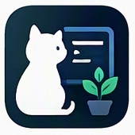
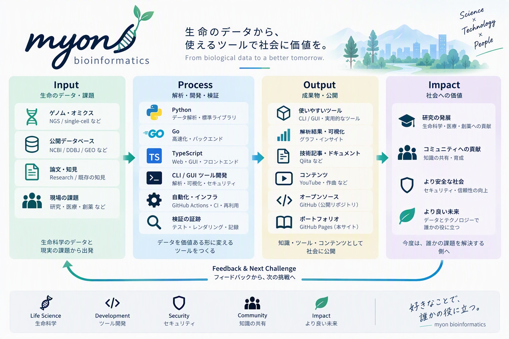
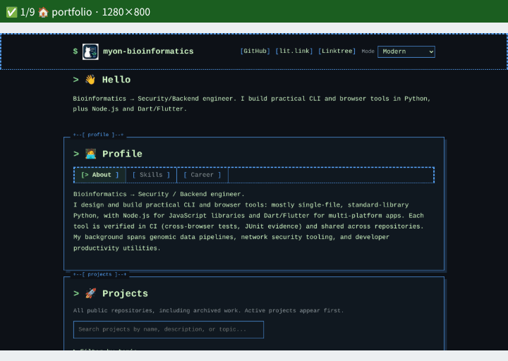

<p align="center">
  
</p>

<h1 align="center">🧭 myon-bioinformatics.github.io</h1>
<p align="center">Personal site & portfolio — built and maintained by <a href="https://github.com/myon-bioinformatics">myon</a></p>

<p align="center">
  
  
  <a href="https://github.com/myon-bioinformatics"></a>
  <a href="https://twitter.com/myonitbusiness"></a>
</p>

Artwork: the supplied cat/code/plant icon and favicon are cropped from the new project brand sheet.
The pair labelled `yourself` is assigned here to the portfolio; the parent and Yourself repository icons remain unchanged.
See [brand assets and concept-review notes](docs/brand-assets.md).

## 🗺️ Concept map

[](assets/brand/repository-concept.jpg)

Concept artwork supplied on 2026-10-22, preserved without modification. It shows
the overall direction; [current technology focus and remaining differences](docs/brand-assets.md#概念図の確認メモ2026-10-22) are recorded separately.

---

## 📍 Live
- **Site:** https://myon-bioinformatics.github.io
- **Intro/Profile:** https://github.com/myon-bioinformatics
- **Links:** <a href="https://lit.link/myon123">lit.link</a> / <a href="https://linktr.ee/myon123">Linktree</a>

> If you’re a beginner or recruiter and want a quick overview of me, the **Intro/Profile** link above is the fastest route.

---

## 🖼️ Latest successful render

The latest successful GitHub Pages deployment publishes deterministic Chromium
screenshots at stable URLs:

- [Desktop 1440×900](https://myon-bioinformatics.github.io/evidence/latest/desktop.png)
- [Mobile 390×844](https://myon-bioinformatics.github.io/evidence/latest/mobile.png)
- [Evidence metadata (SHA / timestamp / viewport)](https://myon-bioinformatics.github.io/evidence/latest/meta.json)

[](https://myon-bioinformatics.github.io/evidence/latest/desktop.png)

These URLs are replaced only by a **successful Pages deployment**, so they act as
a human-readable `latest` view rather than a per-run artifact archive.

The inline README preview uses a cache-busting query only for GitHub's image
proxy. The link target remains the stable `/evidence/latest/desktop.png` URL.

---

## 🧭 Tools & Demos portal
The top page also contains a hand-maintained **Tools & Demos** discovery catalog
for selected live GitHub Pages applications. This is intentionally separate from
the JSON-driven repository cards: adding a new live tool requires updating both
`index.html` and `tests/test_site.py`, so the destination and its HTTPS
Pages-host contract are reviewed together.

🧰 Ironmate's Image Studio, Browser Tools and Slide Studio (`tools/image-studio/`, `tools/browser-tools/`, `tools/slide-studio/`), mcp-toolcall-lab's execution lab (`tools/mcp-toolcall-lab/execution/`) and DRAgoWing's 🌡️ heatmap (`tools/heatmap/`) are built here at deploy time from each repository's default branch (`scripts/project_pages.py --record-tools`; the code stays in those repositories). A build that could not record one leaves a ⏸ page in its place. Ironmate has a local metadata card (`project-ironmate.json`). Its retired MCP stub is not linked. Studio route mapping is build source in `_src/tools/studio_routes.py`; the rendered pages live only in the Pages output tree. Ironmate still owns the generated editor and data formats, and the shared back navigation comes from PySaiyanWeBoo. Live destinations include Ironmate (Image Studio, Browser Tools, and Slide Studio), mcp-toolcall-lab, and PySaiyanWeBoo.

## 🚀 Projects
The Projects section on the [site](https://myon-bioinformatics.github.io) is a hub of every public, non-archived repository.

- Each card states what the project is.
- The project name opens the GitHub repository. **Copy URL** copies that same address.
- **🌐 Pages** opens the project's live GitHub Pages site, when it has one.
- **📄** opens a portfolio page with a recorded example, when the project has a showcase.

Search and topic filters work together across all five display modes. Topic controls expand on demand so the full catalog remains easy to reach on mobile. The candidate pool is shuffled on each page load. Cards, tags, inputs and copy buttons use the same pinned web-ui stylesheets already used by this portfolio’s tool pages (`tools/vendor/web-ui/`, source identity in `vendor.lock.json`). Local CSS only adds catalog layout, mode mapping and filter state; no second component stylesheet is vendored.

`api/repos.json` is the source of truth for membership and repository URLs; archived repositories are not shown. `projects.json` may add a curated description, extra topics, and an optional showcase; it cannot add a repository that is absent from the catalog. If curation is unavailable, the catalog description (then the README summary) is used. A missing catalog shows a load error instead of a misleading partial list.

The catalog refresh runs daily at 06:00 JST. A successful `Update repos API` run on `main` triggers the existing Pages deployment through `workflow_run`, which checks out the refreshed `main`. This explicit handoff is required because catalog commits pushed with `GITHUB_TOKEN` do not trigger `push` workflows. Failed or cancelled refreshes do not publish a new site.

Changes to the Pages workflow also trigger a catalog refresh to exercise this handoff. Render evidence records the actual checked-out commit, including when the refresh or a concurrent update has advanced `main` beyond the event's original SHA.

The header gets its animated face from PSWB’s Python `component_parts("gaze-avatar")` API. Project URL buttons use the same pinned PSWB release’s `copyText` helper. Reusable interaction changes belong in PSWB; the portfolio owns placement, labels and project data.

## 🎛️ Display mode
- Default mode is **modern**
- Repository default can be changed via `site.config.json`:
  - `defaultViewMode`: `modern`, `xml-like`, `json`, `markdown`, or `github-like`
- Users can switch mode from the page header, and their choice is saved in browser local storage.

---

## 🚀 Quick start (Local)
```bash
git clone https://github.com/myon-bioinformatics/myon-bioinformatics.github.io
cd myon-bioinformatics.github.io
python -m http.server 8080
# → http://localhost:8080
```

---

## 🧑‍🎤 About me (short)
I started coding through **Bioinformatics**. Main tools: **Python** (mostly single-file, standard-library tools), plus **Node.js** and **Dart/Flutter**.  
I like building **GUI/CLI tools** for security & backend.

- Skills (JP): https://myon-bioinformatics.github.io  
- Tips (JP): https://qiita.com/myon-bioinformatics  
- Career (JP): https://job-draft.jp/users/58541  
- Composer Portfolio: https://www.youtube.com/@freez-myon  
- Wantedly: https://www.wantedly.com/id/myon123

---

## 🔄 Maintaining project cards

Edit `projects.json` for curated descriptions and extra topics, then validate
the canonical shape using [docs/ssot.md](docs/ssot.md). Catalog membership
comes from `api/repos.json`. There is no pinned-repository generator and no
scheduled card-update workflow.

## 🎞️ Browser evidence



🗓️ 2026-11-07 · 🧭 Chromium 153 · 🐧 Linux · receipt [`docs/evidence/browser.json`](docs/evidence/browser.json)

| 🧪 Suite | ✅ | ⏭️ | 📝 |
| --- | ---: | ---: | --- |
| Playwright Test, generated site (`playwright.generated.config.js`) | 91 | 1 | |
| Playwright Test, source tree (`playwright.config.js`) | 90 | 2 | |
| `pytest tests` | 105 | 0 | +1 local-only: Python/Node browser path differed because this machine aliases Chromium revisions |
| `tools/portable_playwright.py` / `.mjs` (project catalog) | 11 + 11 | | |
| 🎞️ evidence GIF shots | 9 | | |

🌐 Avatars and badges are external and were refused (listed per shot in the receipt). `/tools/mcp-toolcall-lab/execution/assets/…` comes from the execution lab this site builds at deploy time (`--record-tools`), so it is allowed rather than counted as a 404.
🔄 `tools/mcp-toolcall-lab/` is the lab's public export re-imported from its `main` (`6af885d9`); the earlier copy was a 2026-10-24 branch build.
📦 The shared Web UI is one pinned git dependency (the `pages` group in `pyproject.toml` → PySaiyanWeBoo; `uv run --locked --only-group pages` installs it); `web-ui-assets.lock.json` records the commit and the SHA-256 of every generated file (`tools/vendor/web-ui/`, `tools/demos/`, `tools/projects/`). The front page (`index.html`) is built by `scripts/front_page.py` from `profile.json`, `api/repos.json` and `projects.json`: the profile and projects in each display mode (cards, XML-like, JSON, Markdown) are rendered in Python, and the colour themes are PySaiyanWeBoo's palettes. It is not in the lock, because the repository catalog is refreshed by a workflow. None of these files are kept in git: the Pages build writes them, `uv run --locked python scripts/project_pages.py --stage .generated-site` writes the whole site for tests and local previews, and `--refresh-lock` rewrites the lock after the pin moves. To move the pin, change the full commit in `[tool.uv.sources]` in `pyproject.toml`, run `uv lock`, and refresh. The three vendored copies of `web_ui.py` (two generators and a 92 KB adapter) are gone.

🔁 Re-record (after building `.generated-site` as in CI; `$WEBUI` is a PySaiyanWeBoo checkout at `adb23d7`):

```sh
uv run --project ../BrowserTestKit --group pages --group browser python ../BrowserTestKit/tools/evidence_gif.py docs/evidence/browser.gif --serve .generated-site \
  --map "https://cdn.jsdelivr.net/gh/myon-bioinformatics/web-ui@adb23d7ba6ea94672b76457573f6655a081ee054=$WEBUI" \
  --map "https://cdn.jsdelivr.net/gh/myon-bioinformatics/PySaiyanWeBoo@adb23d7ba6ea94672b76457573f6655a081ee054=$WEBUI" \
  --plan docs/evidence/browser.json
```

📱🧰📚 Home-screen shortcuts, the demos (stubs and mocks) and the project pages with their recorded runs, in Chromium:


🗓️ 2026-11-13 · `uv run --locked --only-group browser python -m pytest tests/test_site.py -k home_screen` writes `test-results/home-screen/home-screen-shortcut-<UTC>.gif` (CI keeps it in the browser evidence artifact); copy the newest one to `docs/evidence/home-screen.gif` to update this.

### 🌍 ワールド

Tools & Demos → **🌍 ワールド** (`tools/demos/`) は、1ページの中を絵文字のキャラで歩くワールドです：🌍 旅（`world.html`、🚪 で土地をわたる）・🏫 スクール（`school.html`）・🗼 パラレルシティ（`cities.html`、パラレル東京・リバースロンドン・フェイクパリ）・🎬 カメラ（`world-shots.html`）。ページ遷移もリロードもなく、HTML・CSS・小さなスクリプトは `scripts/world.py` が書きます（見た目・テーマ・ダイヤル・座標は PySaiyanWeBoo）。

```sh
uv run --locked --only-group pages python scripts/world.py example school | uv run --locked --only-group pages python scripts/world.py page - > school.html
uv run --locked --only-group samples python scripts/world.py record media/world --force     # 🎞 demo GIFs from real Chrome
uv run --locked --only-group browser python tests/world_browser.py -v                      # 🧪 every world in Chromium
```

📖 [教室・土地・実在の場所](docs/world-classroom.md) · [動き](docs/world-motion.md) · [共有掲示板](docs/world-shared-board.md)。PySaiyanWeBoo から移しました（同じページを描きます）。

### 地図URL・ピン留め

Tools & Demos → **地図URL・ピン留め** (`tools/maps/`) で、緯度・経度からApple MapsとGoogle MapsのURLを生成できます。地図URLからの座標入力、端末内のピン保存・解除、地点リンクのコピー、端末の共有メニューに対応します。共有先は保存操作なしで同じ座標を開けます。ピンはブラウザごとの保存で、端末間では同期しません。保存やコピーが許可されていない場合は画面に表示します。

パラレル東京 (`tools/maps/tokyo.html`) の各地点と相互に移動できます。座標・地図URL生成は固定済みPSWB、ミニチュアは `scripts/world.py` から再利用します。東京の座標はミニチュア用の概略値で、施設の正確な入口を保証するものではありません。URLだけを作るため地図APIキーは不要です。

Flutterの範囲指定も引き継いでいます。中心＋半径（25 / 100 / 350 / 1,000 / 3,000 m・自由指定）から南北東西の境界と範囲URLを生成し、半径をピン・共有リンクに保存します。初期値は100 m、0は地点のみです。範囲内の東京の地点は中心からの直線距離で絞り込み、移動先から戻っても半径を保持します。「元の指定範囲へ戻る」は元の中心も復元します。範囲URLは表示範囲の指定で、円や矩形を地図上に描画するものではありません。日付変更線・極付近では表現できないApple Mapsの`spn`を省略します。

```sh
uv run --locked --only-group browser python -m pytest tests/test_maps.py -q
```

このテストはピン保存・再読込・共有先の別ブラウザ・東京の対応地点を確認し、`test-results/maps/map-links-pins-<UTC>.gif` と実行結果JSONを自動保存します。CIの `portfolio-browser-evidence` artifactにも含まれます。共有メニューはブラウザAPIへの引き渡しをテストし、実機の共有先アプリでの受信は対象外です。

BrowserTestKitの共通レコーダーでも操作プランから再生成できます（GIFと実行記録JSONを出力）。

```sh
uv run --locked python scripts/project_pages.py --stage .generated-site
uv run --locked --only-group browser python ../BrowserTestKit/tools/evidence_gif.py \
  test-results/maps/walkthrough.gif --serve .generated-site \
  --plan docs/evidence/maps-plan.json --timestamp --git-commit
```

GIFは操作確認用です。テストの成否はpytestのアサーションと実行結果で確認します。

## 🧪 CI evidence

The catalog refresh keeps its latest-Python-3 lane using setup-uv's `"3"`
selector with `UV_PYTHON_PREFERENCE=only-managed` during environment creation.
uv tracks its latest stable release at run time; the setup-uv action remains
pinned by full commit SHA. This selects the newest stable Python 3 offered by
the uv provider selected for that run,
not an older Python already installed on the runner; it does not promise a
Python release newer than that provider knows. Other migrated CI jobs use 3.15.

[CI](.github/workflows/ci.yml) and the Python job in
[Stagehand v4 dual-SDK reference](.github/workflows/stagehand-v4-reference.yml)
produce pytest JUnit and call the parent's pinned shared failure-identity
collector. Raw artifacts are `junit-portal-py3.15` and
`junit-stagehand-python-py3.15`, retained for 14 days. Compact artifacts are
`portal-failure-identity` and `stagehand-python-failure-identity`; the shared
collector does not set `retention-days`, so repository-default retention applies. Missing or invalid expected XML fails collection; the original
test exit code remains authoritative.

The Stagehand reference checks SDK surfaces. Its separate screenshot job uses
Playwright Chromium; it does not demonstrate Stagehand agent execution. See
[docs/stagehand-v4-reference.md](docs/stagehand-v4-reference.md) for the reference scope. Pages deployment owns the
stable `evidence/latest/` screenshots described above.

---

<details>
<summary>🇯🇵 日本語版 (クリックで展開)</summary>

このリポジトリは**GitHub Pagesサイト**です。説明文と追加トピックは `projects.json`、掲載対象は `api/repos.json` です。  
ローカル確認は `python -m http.server` でOK。ピン留めリポジトリからカードを作る処理や、その定期workflowはありません。編集・検証手順は [docs/ssot.md](docs/ssot.md) を参照してください。
</details>

## Lab public tools and reports

The portfolio now receives the lab's public Wiki/Pixiv interfaces and exported
Actions report under `tools/mcp-toolcall-lab/` (`#wiki`, `#pixiv` and `#pokemon`). MCP servers,
Docker execution, raw traces, and test generation remain in mcp-toolcall-lab.
Flutter's working Pages application is unchanged.

The [Execution Lab](https://myon-bioinformatics.github.io/tools/mcp-toolcall-lab/execution/) is the browser execution interface, built here from mcp-toolcall-lab's default branch at deploy time (`--record-tools`) and separate from this imported report.
The portfolio Wiki form starts empty: examples do not prefill a personal location.

The initial import is the public export observed on 2026-10-08, with source
identity `3b15b7911695fc76fa8cd01f514e57133fb02d83` (2026-10-05).
Its original `dirty: true` observation is preserved, not silently corrected.
It is explicitly labelled an imported snapshot, not the latest Actions result.
`publication.json` records source and published file hashes and import time.
Only public report files are admitted; raw MCP/anti-pattern logs are excluded.
Existing source copyright and repository LICENSE apply to transferred assets.

To update, obtain a trusted lab `stub-pages-observations` artifact, extract its
`_site/` public export, then run:

```sh
uv run --locked python scripts/lab_import.py --source /path/to/export/_site
uv run --locked pytest tests/test_site.py
```

Review and commit the imported output in a PR. No untrusted archive is extracted
by this helper; it receives an already extracted trusted directory. There is no
automatic claim that an imported snapshot equals the newest run. The lab-side
legacy redirect must land only after this portfolio receiving change is deployed.

### Shared browser controls

HTML Import exposes an explicit HTTP(S) source link in a new tab; pasting or changing extraction options stays local. `web-ui` owns `source_link`, `view_tabs`, `adopt_document`, and `navigation.js`. The portfolio vendors the pinned implementation and keeps the lab report source identity separate from its shared presentation transform. Wikipedia/Pixiv typography and controls use that same modern theme. See [HTML Import contract](docs/html-import.md).

Pixiv source now supports a local heading dropdown through a consumer adapter.
See [source grammar, Python one-liners, and markdown.py integration](docs/pixiv-markup.md).

### Portfolio search, highlights and image evidence

- Project text search and topic filters work together in each view mode.
- The lab's Niconico tab attempts Snapshot Search API v2 from the browser. Live verification on 2026-10-21 JST found HTTP 200 JSON responses without `Access-Control-Allow-Origin`; the published browser could not read results. The panel explains this limitation and offers official Niconico search with the selected keyword/sort. GitHub Pages cannot fix an upstream CORS header. The portfolio owns `tools/niconico/` and reapplies this panel when importing a lab report. See [live verification](docs/evidence/niconico-live-20261021/README.md).
- AI & Tech Highlights displays public GitHub search results, or explicitly labelled curated examples when the API is unavailable. Curated examples do not claim current star counts.

Verification: `uv run --locked pytest tests` (includes the canonical-data check of `docs/ssot.md`) and, in a browser, `uv run --locked --group browser python -m pytest tests/test_front_page.py` (the front page, Python Playwright) plus `npx playwright test --config playwright/html-import.config.js` (HTML import and MCP lab; the Docker contract runs it on Chromium and WebKit). Python test dependencies are the `test` and `browser` groups of `pyproject.toml`, pinned in `uv.lock`; the brand-asset tests read images with the vendored `pillow_min` module from the parent repository's `tools/stdlib_min/` (`vendor/pillow_min.py`, recorded in `vendor.lock.json`). Animated evidence is the GIF recorded with BrowserTestKit's `tools/evidence_gif.py` (see Re-record above). The portal workflow preserves browser evidence as an Actions artifact.

## Browser suite without a Playwright install

The Docker contract and published acceptance workflows share `.github/actions/html-import-image`.
Main push builds save BuildKit dependency layers in the Actions cache; both workflows reuse them.
The lockfile pins Playwright and its browser builds, so dependency changes rebuild the browser layer.
The first build or an evicted cache downloads browsers again. Source edits reuse dependency layers;
local `.venv` and `.generated-site` directories are excluded from the Docker context.

Without Playwright's own Chromium installed, run the browser suite with a browser already on disk through
BrowserTestKit: `python ../BrowserTestKit/tools/btk.py pw-test --root . --config playwright/html-import.config.js tests/html-import.spec.js` (the portable
runner that used to live here).

### Shared asset generator entry points

```sh
uv run --locked python scripts/project_pages.py --stage .generated-site   # the whole site; the Node browser specs serve it
uv run --locked python scripts/project_pages.py --output /tmp/portfolio-site  # the generated files only
uv run --locked python scripts/project_pages.py --refresh-lock
uv run --locked python -c "from scripts.project_pages import main; main(['--output', '/tmp/portfolio-site'])"
```

`main(argv=None)` uses process arguments when omitted and accepts an explicit argument
list after import. Both `--output` and `--refresh-lock` may be supplied together.
Normal generation verifies the installed git commit, dependency pin and all asset hashes
before writing output. Refresh only accepts the installed commit specified in the pin;
rendering or provenance failures leave the previous lock and checked-in assets intact.
