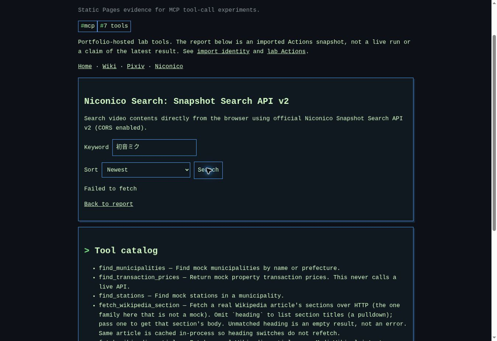

# Niconico live verification — 2026-10-21 JST

Published source: `935b64c9e320750a586ff847d6f964145f527361` (PR #63, after #61).
Page: https://myon-bioinformatics.github.io/tools/mcp-toolcall-lab/#niconico
Implementation: `tools/niconico/search.js`.

## Real communication (no mock)

| Check | Observation | Outcome |
| --- | --- | --- |
| Published page, 初音ミク, Views (High to Low) | Clicked Search in cloud Chrome; `Failed to fetch`, no result cards | Failed |
| Published page, 初音ミク, Newest | Selected Newest and clicked Search; `Failed to fetch`, no result cards | Failed |
| Direct HTTP API, `-viewCounter` | HTTP 200, JSON `meta.status=200`, totalCount 393646, 10 rows, descending viewCounter | Passed for HTTP only |
| Direct HTTP API, `-startTime` | HTTP 200, JSON `meta.status=200`, totalCount 393646, 10 rows, descending startTime | Passed for HTTP only |
| Cross-origin permission | Both real responses omitted `Access-Control-Allow-Origin` with `Origin: https://myon-bioinformatics.github.io` | Does not permit browser reading |
| Result → video navigation | No live cards were available. Opening the returned first video `sm15630734` separately was denied by the cloud browser's site-safety policy before page observation | Not verified |
| Real HTTP errors, real 10-second stall, overlapping real requests | Not induced against the external service; abort/race tests below are controlled simulations | Not claimed as live success |

[http.json](http.json) records request URLs, selected response headers, meta, ten IDs/titles/view counts/timestamps, sort checks and SHA-256 of full response bytes. It is explicitly labelled `live-http-not-browser` and `mocked:false`. Calls are sequential and include an idle interval at least as long as the preceding response duration. No retries were made by the probe.



## Cause and scope of the fix

The missing CORS response header is sufficient to prevent a standards-compliant cross-origin `fetch` from exposing the response body to this Pages origin. The browser's generic failure is consistent with that restriction. Cloud browser logs did not expose a more specific API network diagnosis, so this record does not claim that every browser failure was exclusively caused by CORS, or that the upstream will omit this header forever. HTTP success is not browser acceptance.

GitHub Pages serves static files; client JavaScript cannot add the API server's response header. `mode: no-cors` would yield an unreadable opaque response. This PR corrects the unsupported “CORS enabled” claim, explains network/CORS failure without pretending to distinguish the two, and adds a direct official-search link preserving keyword and sort. Destination availability of that link remains unverified in this cloud browser. No public proxy, credential, backend, or deployment setting was introduced. In-panel real API search remains unavailable under the observed CORS response; a future owner-controlled backend or upstream CORS support would be needed to restore it.

The fix also rejects malformed JSON/rows/counts before rendering, caps rendering at ten, checks abort again after the response body resolves, clears completed request state, and gives HTTP 503 its documented minimum five-minute retry advice. The displayed results remain API data only; the official search link does not fabricate local cards.

## Controlled tests and repeatable live probes

`tests/niconico-lab.spec.js` uses mocks/fetch doubles, never the external API. It covers safe title/link rendering, query/sort encoding, empty/invalid/HTTP/network responses, fallback encoding and sorts, non-JSON/null rows/invalid descriptions/IDs/counts, ten-result bound, HTTP 429/503, timeout at 9999/10000 ms and recovery, previous-request abort, late stale response suppression, and late-body timeout. These tests cannot establish live API accessibility.

Local publication tests: **6 passed**. SSOT validation and JavaScript syntax checks passed. Local Playwright browser execution is blocked by an unusable Chromium download (truncated/non-ZIP response); browser regression results will be recorded from PR CI separately.

Manual repeat commands:

```sh
# Real HTTP only; exit 0 means schema/order success, not CORS acceptance.
python -S scripts/probe_niconico_live.py --output reports/niconico-http.json
# Deterministic mock/browser regression suite.
npx playwright test tests/niconico-lab.spec.js
# Opt-in real published browser acceptance. No routes or mock responses.
NICONICO_LIVE=1 npx playwright test --config playwright.niconico-live.config.js
```

The opt-in browser test attaches actual observations and fails if either search has no ten result links. It is skipped in ordinary CI and was not run locally because Chromium could not be installed. It must not be cited as passed merely because its mock counterpart passed.

Official API guide consulted: https://site.nicovideo.jp/search-api-docs/snapshot
(HTTP statuses/JSON fields, intervals between requests, and at least five minutes before retrying 503).

## Independent review follow-up

An independent check of the official search page's actual HTTP 200 HTML and
`server-response` metadata found that `sort=like` silently selected the default
“ニコニコで人気” instead of “いいね！数”. The fallback and its regression expectation
now use `sort=likeCount`. The official response selected the expected sort keys:

| Panel selection | Official URL sort | Active official sort key |
| --- | --- | --- |
| Views | `v` | `viewCount` |
| Newest | `f` | `registeredAt` |
| Likes | `likeCount` | `likeCount` |
| Mylists | `m` | `mylistCount` |

`order=d` selects descending order. Checks used the official search destination
`https://www.nicovideo.jp/search/初音ミク`; this verifies HTTP destination/parameter
recognition, not a successful browser API search or video playback.

The 9999/10000 ms regression initially failed locally because its installed clock
continued advancing during click/route handling. It now pauses before issuing the
request so the boundary assertions measure only explicit clock advancement.
After that correction, all 22 relevant browser cases (17 mocked Niconico cases
and five existing publication/Pixiv cases) passed using the available headless
Chromium executable. Python checks: 56 passed, one optional Stagehand dependency
check skipped in this local environment. SSOT validation, JavaScript syntax and
`git diff --check` passed. PR CI remains the authority for the normal browser
configuration and complete suite.

In-panel real API search is still unavailable under the recorded upstream CORS
response. Restoring it requires API-provider CORS support or an owner-controlled
backend; this follow-up only repairs the official-search fallback and a test.
